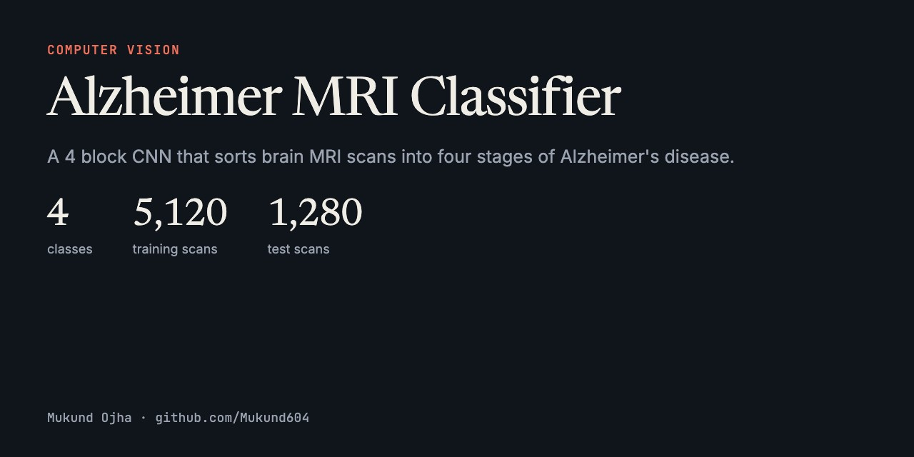
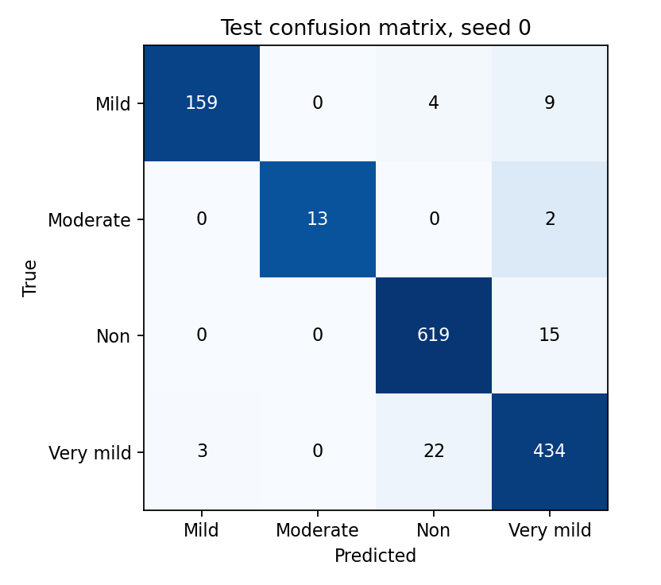
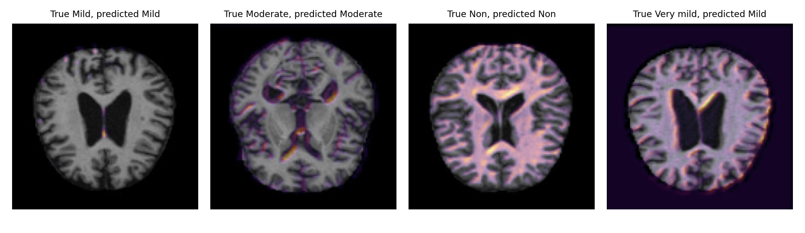

# Alzheimer's MRI Scans Classifier using CNN



A Convolutional Neural Network (CNN) that classifies Alzheimer's MRI scans into four categories: **Mild Demented**, **Moderate Demented**, **Non Demented**, and **Very Mild Demented**.

## Table of Contents
- [Overview](#overview)
- [Dataset](#dataset)
- [Model Architecture](#model-architecture)
- [Results](#results)
- [Reproduce](#reproduce)

## Overview

Alzheimer's disease is a progressive neurodegenerative disorder that affects millions of people worldwide. Early and accurate diagnosis is crucial for effective management and treatment. This project utilizes deep learning to develop a classifier that can identify the stage of Alzheimer's disease from MRI scans across four classes.

## Dataset

The dataset is sourced from the [Alzheimer MRI Disease Classification Dataset](https://www.kaggle.com/datasets/fernando2rad/alzheimer-mri-disease-classification-dataset) on Kaggle. It contains MRI brain scans in parquet format, labeled into four classes:

| Label | Class |
|-------|-------|
| 0 | Mild Demented |
| 1 | Moderate Demented |
| 2 | Non Demented |
| 3 | Very Mild Demented |

- **Training samples:** 5,120
- **Test samples:** 1,280
- **Image size:** 128x128x3

## Model Architecture

Two convolution blocks (32 and 64 filters, each with ReLU, max pooling and dropout) and a flatten layer into 4 outputs. See `CNN` in [`train.py`](train.py). The original Keras version is in the notebook.

## Results

Mean over 3 seeds on the untouched test split of 1,280 scans. The split is imbalanced: Moderate Demented has 49 training scans and 15 test scans, so accuracy alone flatters a model.

| Model | Accuracy | Balanced accuracy | Macro F1 |
| :--- | ---: | ---: | ---: |
| Always predict the largest class | 49.5% | 25.0% | 0.166 |
| Logistic regression on pixels | 96.9% | 94.1% | 0.959 |
| **CNN (mean of 3 seeds)** | **96.7% ± 0.8** | **95.6% ± 2.0** | **0.967 ± 0.014** |





*Grad-CAM from a separate retraining with the same settings. It shows where the network looked, not whether it looked at the right anatomy.*

### Why I don't trust these numbers much

**Plain logistic regression on raw pixels ties the CNN.** That shouldn't happen on a hard vision problem, and it points to a problem with the split rather than a great model.

The dataset has no patient IDs, so neighboring slices from one patient can land in both train and test. As a rough check, 97.9% of test images have a training image with a correlation above 0.98 (median 0.994). Brain scans all look alike, so this can't prove leakage by itself, but with the baseline result it's a strong warning.

A trustworthy estimate needs a patient level split, which this dataset can't support. **Treat these scores as an upper bound. This is a learning project and not a medical tool.**

### What I changed from the first version

* **Moved to PyTorch** with stratified validation splits, as the original unshuffled split could leave the rare class to chance.
* **Model selection on validation only.** The test split is scored once per seed.
* **Tried a deeper model and dropped it.** Four blocks with batch normalization and global pooling reached a validation macro F1 of only 0.31 after 15 epochs, against 0.93 for this smaller flatten model. That gap is another hint the task rewards memorizing position.
* The notebook's old 95.23% headline had no saved output behind it, so it's kept for history only.

## Reproduce

```
pip install -r requirements.txt
# put the two parquet files from huggingface.co/datasets/Falah/Alzheimer_MRI in data/
python train.py --data-dir data
pytest
```
